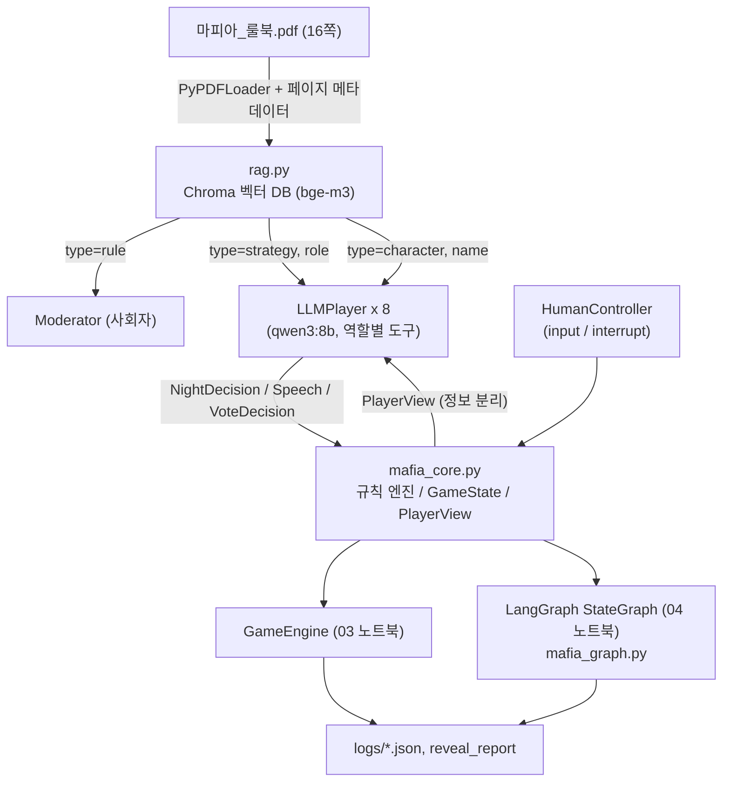
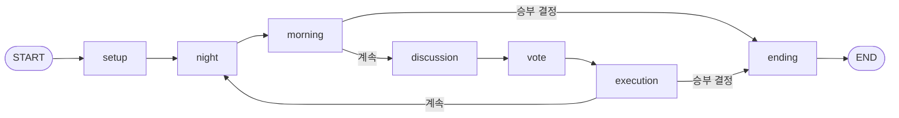

# 08_Mafia_Agent - 멀티 에이전트 마피아 게임

딥러닝실습 "나만의 에이전트 만들기" 과제. 로컬 LLM(Ollama `qwen3:8b`) 8명이 마피아 게임을 하고,
사람 1명이 AI 7명과 함께 참여할 수도 있다. LangChain(RAG, Tool, Agent) + LangGraph(상태 머신)로 구현했다.

## 집 PC에서 이어서 작업하기 (Windows)

1. [Git for Windows](https://git-scm.com/install/windows), [Python 3.11.9](https://www.python.org/downloads/release/python-3119/), [Ollama](https://ollama.com/download/windows), VS Code(Python·Jupyter 확장)를 준비한다. Ollama 앱을 켜 둔다.
2. 아래 명령을 실행한다. 공개 저장소라 내려받기(clone, pull)에는 로그인이 필요 없고, 올리기(push)할 때만 GitHub 계정(`seah1006`)으로 로그인한다.

```powershell
git clone https://github.com/seah1006/mafia-agent.git
cd mafia-agent
.\setup.ps1
```

`setup.ps1`은 Python **3.11.9**를 확인해 저장소 안에 `.venv`를 만들고, `requirements.txt`의 패키지와 없는 Ollama 모델(`qwen3:8b`, `bge-m3`)을 내려받는다. Python을 다른 위치에 설치했다면 `-PythonExe '경로\python.exe'`를 추가한다. 모델 다운로드에는 수 GB의 여유 공간이 필요하다.

3. VS Code에서 `mafia-agent` 폴더를 열고 노트북 우측 상단의 **Select Kernel → Python Environments → `.venv`**를 선택한다. 노트북 **01 → 02 → 03 또는 04** 순서로 실행한다. `01`은 집 PC에서 벡터 DB를 새로 만들기 위해 필요하다. 03/04의 직접 참여 셀은 입력을 기다리고, 04의 마지막 LLM 여러 판 통계 셀은 오래 걸려 필요할 때만 실행한다.

PowerShell이 스크립트 실행을 막으면 정책을 바꿀 필요 없이 아래 명령으로 같은 준비를 할 수 있다. `py -3.11 --version`이 **3.11.9**인지 먼저 확인한다. Python Launcher가 없으면 `py -3.11` 대신 설치된 `python.exe`의 전체 경로를 사용한다.

```powershell
py -3.11 --version
py -3.11 -m venv .venv
.\.venv\Scripts\python.exe -m pip install -r requirements.txt
ollama pull qwen3:8b
ollama pull bge-m3
```

**PC 사이 동기화:** 작업 시작 전 `git pull --ff-only`, 작업을 마친 뒤 변경 파일을 `git add`하고 `git commit`, `git push`한다. `.venv/`, `vector_db/`, `logs/`와 Ollama 모델은 Git으로 옮기지 않는다. 노트북을 실행하면 출력도 바뀌므로 `git status`로 커밋할 파일을 확인한다.

## 터미널에서 한 번에 실행하기

노트북 없이 터미널 한 줄로 실행할 수 있다. Ollama 앱이 켜져 있어야 하고, 벡터 DB 가 없으면 처음 실행 때 자동으로 만든다.

```bat
run.bat            :: 메뉴에서 고르기
run.bat watch      :: 관전 모드: AI 8명 + 사고 과정 보기 (한 판 4~10분)
run.bat watch --quiet --seed 11   :: 사고 과정 없이, 같은 배정으로
run.bat play       :: 참여 모드: 나 1명 + AI 7명 ('?질문' 으로 사회자에게 규칙 문의)
run.bat replay     :: 녹화된 실제 한 판 다시 보기 (LLM 호출 없음, 즉시)
run.bat ask        :: 질문하기: 해설 에이전트(녹화된 판) + 사회자(룰북)
```

- `run.bat` 은 `.venv` -> 상위 폴더 `venv`(수업용) -> `python` 순서로 파이썬을 찾아 `play.py` 를 실행한다. PowerShell 터미널이면 `.\run.bat` 처럼 앞에 `.\` 를 붙인다.
- 관전/참여 판이 끝나면 역할과 속마음을 공개하고, 그 판에 대해 해설 에이전트에게 바로 질문할 수 있다.

## 1. 구현 컨셉

### 1-1. LLM은 연기, 진실은 코드가 지킨다
- LLM(qwen3:8b)이 하는 일: 캐릭터 말투로 **발언**, 의심 정도 추론, 누구를 죽일지/살릴지/조사할지/투표할지 **선택**.
- 코드(`mafia_core.py`)가 하는 일: 역할 배정, 밤 결과 판정(처치 vs 보호), 투표 집계와 동점 재투표, 승리 판정, 사망자 직업 공개.
- 작은 모델은 규칙을 어기거나 잊어버리기 쉽다. 그래서 규칙 판정에 LLM을 한 번도 쓰지 않는다. LLM이 틀려도 게임은 올바르게 진행된다.

### 1-2. 정보 분리 (PlayerView)
- 각 AI에게는 `PlayerView`만 전달된다. 이 안에는 공개 기록, 자기 역할, **자기만 아는 정보**(경찰 조사 결과, 마피아 동료)만 들어 있다.
- 다른 사람의 역할, 전체 `GameState`, 다른 AI의 속마음은 프롬프트에 절대 들어가지 않는다. (`02_agent_test.ipynb`에서 눈으로 확인)
- 게임이 끝난 뒤에만 `reveal_report()`로 전원의 역할과 속마음을 공개한다.

### 1-3. 역할별 도구 (Tool)
| 역할 | 사용 도구 |
|---|---|
| 공통 | `search_strategy`(내 역할 전략 검색), `read_my_notes`(내 과거 속마음), `vote` |
| 마피아 | `choose_kill_target` |
| 경찰 | `investigate` |
| 의사 | `protect` |
| 시민 | 밤 행동 없음 (전략 검색, 투표만) |

도구는 "선택을 기록"하는 역할이고, 선택이 유효한지는 코드가 다시 검사한다.

### 1-4. RAG 메타데이터 필터
- 룰북 PDF(16쪽)를 페이지 단위로 읽고 페이지마다 메타데이터(`type`: rule/strategy/character, `role`, `name`)를 붙여 Chroma에 저장.
- 질의 목적에 따라 필터 검색:
  - 사회자 규칙 질문 -> `type=rule`
  - 역할 전략 조언 -> `type=strategy AND role=내 역할` (마피아 AI가 시민 전략 페이지를 읽는 일이 없다)
  - 캐릭터 페르소나 -> `type=character AND name=내 이름` (질의 없이 정확히 1쪽)
- 벡터 유사도만으로는 역할/종류가 섞이므로 메타데이터 필터로 "읽어도 되는 문서"를 먼저 제한한다.

### 1-5. 안전장치
| 문제 | 대응 |
|---|---|
| LLM 출력 형식 오류 / 없는 대상 이름 | `normalize_choice`로 퍼지 매칭 -> 재시도(`LLM_MAX_RETRIES`) -> 무작위 유효 대상으로 대체 (`safe_decide`) |
| LLM 호출 예외 | 같은 경로에서 잡아서 대체. 게임은 멈추지 않는다 |
| 정체 노출 ("나 마피아야") | `contains_role_leak`로 검사, 걸리면 재생성/대체 (`leak_blocked` 통계) |
| 확정 정보와 모순되는 투표 (마피아가 동료에게, 경찰이 확인된 시민에게) | 자기 일관성 검사 -> 경고 + 모순 대상을 후보에서 빼고 재질문 (`LLMPlayer.vote`) |
| 발언 반복 / 이름 없는 막연한 의심 / 자기 이름을 3인칭으로 부름 / 첫 토론인데 '어제' 일을 지어냄 | 문자 bigram 유사도와 규칙으로 감지 -> 이유를 알려주고 1회 재생성 |
| 추리 재료 부족 | 사망자/직업, 날짜별 투표표, 처형된 시민에게 투표한 사람을 **코드가 계산**해 프롬프트에 넣음 (LLM 은 해석만) |
| 경찰이 확인한 정보를 쓰지 못하고 죽음 | 마피아를 찾았거나, 2일차 이후이거나, 오늘 2명 이상에게 의심받으면 코드가 "정체 공개 시점"으로 판단해 지시. 공개된 경찰 주장은 코드가 목록으로 정리해 모두에게 제공(사망 후 직업이 공개되면 진위도 표시) |
| 한 사람에게 같은 질문이 몰리는 몰아가기 | 오늘 3명 이상이 같은 사람을 언급하면 같은 말 반복 대신 새 근거나 다른 대상을 요구 |
| 첫 토론인데 '어제' 이야기, 볼 수 없는 '밤에 움직였다' 이야기 | '어제'는 코드가 같은 날 '아까'로 교정, 밤 행동 근거는 감지 후 재생성 |
| 속마음이 공개 발언을 그대로 복사 | 감지하면 의심도와 발언 목표로 코드가 요약(`[코드 요약]` 표시, 없는 생각을 지어내지 않음) |
| 무한 루프 | `MAX_DAYS` 초과 시 무승부 |
| 느린 응답 | think 모드 끔, 발언 길이 제한, 사이클당 LLM 호출 수 최소화 |

### 1-6. 사고 과정 보기 (챗봇과의 차이를 눈으로 확인)
챗봇은 "사람이 묻고 LLM 이 답한다". 이 프로젝트의 AI 는 **각자 다른 목표와 정보를 가진 8명이 스스로 판단하고 도구를 써서 행동한다**.
관전 모드에서 `build_controllers(state, vs, show_thinking=True)` 로 만들면 결정마다 아래 상자가 출력된다.

```
    ┌─ 사고 과정 · 경찰 윤서진 · 발언
    │ 받은 정보(PlayerView): 생존 7명 · 공개 기록 7줄 · 지난 속마음 1개 · 후보 6명
    │ 나만 아는 정보: 1일차 밤 조사 결과: 박준수는 마피아입니다
    │ RAG 검색: p.6 경찰 전략 가이드 (role=police 필터) / p.10 캐릭터 프로필: 윤서진 (name 필터)
    │ 전략 판단(코드): 경찰 정체와 조사 결과를 공개할 시점 -> 정보공개 지시
    │ 1차 생성: 안전장치 작동(자기 이름 3인칭) -> 재생성
    │ 속마음(비공개): 박준수는 이미 조사로 마피아로 확인되었으므로, 그를 지목하고 투표하도록 유도해야 합니다.
    └─ 발언 목표: 지목
[윤서진] 나는 경찰입니다. 조사 결과 박준수는 마피아입니다. 박준수에게 투표해야 합니다.
```

- 밤 행동과 투표 상자에는 `create_agent` 가 실제로 호출한 **도구 이름과 인자**(`investigate(target='박준수')`)와 도구의 응답이 그대로 찍힌다.
- 사고 과정은 다른 사람의 비밀을 보여 주므로 **관전 모드에서만** 켜진다. 사람이 참여하면 자동으로 꺼진다(정보 분리 원칙).
- 발표 시간에 맞추기 위해 같은 코드로 미리 진행한 실제 한 판을 `data/demo/` 에 저장했고, `03` 노트북 3번 섹션에서 다시 출력할 수 있다(LLM 호출 없음).

### 1-7. 질문에 답하는 에이전트 (05 노트북)
사용자가 질문하면 에이전트가 RAG 로 근거를 찾아 출처와 함께 답한다.

| 부분 | 검색 대상 | 흐름 |
|---|---|---|
| 사회자 `Moderator.explain_rule` | 룰북 규칙 페이지 (`type=rule`) | 질문 -> 검색 -> 답변 + 출처 페이지. 룰북에 없으면 "모른다" |
| 해설 에이전트 `mafia_qa.GameQA` | 룰북 + 끝난 게임의 기록(발언, 투표, 밤 행동, 선택 이유, 속마음) | `create_agent` 가 `search_rulebook` / `search_game_log` / `player_summary` 중 필요한 도구를 골라 호출 -> 근거와 함께 답변 |

- 게임 기록은 한 줄씩 문서로 나누고 `kind`, `day`, `actor`, `target` 메타데이터를 붙여 메모리 Chroma(bge-m3)에 넣는다. "경찰", "마피아" 같은 역할 이름으로도 필터 검색한다.
- 게임 기록에는 비밀이 들어 있어 **게임이 끝난 뒤에만** 만든다(`from_state()` 는 진행 중이면 거부).
- 에이전트가 도구 없이 답하려 하면 코드가 두 저장소를 모두 검색해 근거를 준 뒤 다시 답하게 한다.
- 판 전체 확정 사실(결과, 팀별 명단과 인원, 날짜별 사망/처형, 밤 행동과 경찰 조사 결과, 의사가 살린 횟수, 최종 생존자와 승리 이유)은 `game_summary()` 가 계산해 시스템 프롬프트에 넣고 `game_overview` 도구로도 준다. 검색에 한 명만 걸려 "마피아는 1명"이라고 답하거나, 기록을 잘못 세거나, 조사 결과를 지어내던 문제를 막는다. `player_summary` 는 '마피아들', '마피아팀', '모든 플레이어' 같은 표현도 명단으로 바꾼다.

```
[질문] 경찰은 첫날 밤에 누구를 조사했고 결과가 뭐였어?
    ┌─ 에이전트가 고른 도구
    │ player_summary(player='경찰')
    └─ 6.6초
[답변] 경찰은 첫날 밤에 강태호를 조사했고, 결과는 마피아였습니다.
```

### 1-8. create_agent(LangChain) vs LangGraph 비교
| 구분 | LangChain `create_agent` | LangGraph `StateGraph` |
|---|---|---|
| 역할 | 한 명의 AI가 도구를 골라 쓰는 **개별 판단** | 게임 전체의 **진행 순서와 상태** 관리 |
| 이 프로젝트에서 | 밤 행동/투표의 도구 호출 (`LLMPlayer`) | 밤 -> 아침 -> 토론 -> 투표 -> 처형 -> 승리 판정 흐름 (`mafia_graph.py`) |
| 흐름 제어 | LLM이 정함 (자유도 높음) | 개발자가 노드/엣지로 정함 (예측 가능) |
| 분기 | 없음 (도구 호출 반복) | conditional edge (승리 여부에 따라 종료/계속) |
| 사람 개입 | 어려움 | `interrupt()` + `Command(resume=...)` 로 입력 대기/재개 |
| 중간 저장 | 없음 | checkpointer(`MemorySaver`) + `thread_id` |

즉 **개별 AI의 두뇌는 create_agent, 게임의 심판과 진행은 LangGraph**로 역할을 나눴다.
`03_mafia_game.ipynb`는 `GameEngine`(순수 파이썬 루프)로, `04_langgraph_mafia.ipynb`는 같은 규칙 함수를 재사용한 그래프로 실행한다.

## 2. 시스템 구조도



LangGraph 흐름:



## 3. 파일 설명

| 파일 | 설명 |
|---|---|
| `config.py` | 경로, 모델명, 게임 상수, 캐릭터, PDF 페이지 메타데이터 |
| `data/마피아_룰북.pdf` | 룰북 + 전략 가이드 + 캐릭터 설정집 (16쪽) |
| `rag.py` | PDF 로드/청킹/Chroma 구축, 메타데이터 필터 검색 |
| `mafia_core.py` | 규칙 엔진, 상태, PlayerView, 안전장치, GameEngine, Random/Human 컨트롤러 |
| `mafia_agents.py` | LLMPlayer(역할별 도구), Moderator, `build_controllers` |
| `mafia_graph.py` | LangGraph 버전의 게임 진행 그래프, 사람 입력(interrupt) 처리 |
| `play.py`, `run.bat` | 터미널 실행기 (관전 / 참여 / 녹화 재생 / 질문하기) |
| `mafia_qa.py` | 질문에 답하는 해설 에이전트 (룰북 RAG + 게임 기록 RAG + 코드 계산 도구) |
| `01_create_db.ipynb` | PDF -> 메타데이터 -> 청킹 -> 벡터 DB 구축, 필터 검색 시연 |
| `02_agent_test.ipynb` | AI 1명 단위 테스트: 정보 분리, 발언/투표/밤 행동, 정체 노출 테스트, fallback |
| `03_mafia_game.ipynb` | GameEngine 버전 게임 (관전 모드 / 참여 모드), 종료 후 속마음 공개 |
| `04_langgraph_mafia.ipynb` | LangGraph 개념 설명, 그래프 시각화, 실행, human-in-the-loop, N판 통계 |
| `05_ask_agent.ipynb` | 질문에 답하는 에이전트: 사회자 룰북 Q&A, 끝난 게임에 대한 해설 에이전트 Q&A |
| `data/demo/` | 시연용으로 미리 진행한 실제 한 판 (진행 화면 `demo_game.txt`, 로그 `demo_game.json`) |
| `tests/` | 코어/에이전트 자동 테스트 |
| `requirements.txt` | 고정된 패키지 버전 |
| `vector_db/`, `logs/` | 실행 시 생성되는 벡터 DB와 게임 로그 |

## 4. 실습실 PC 세팅 순서 (Windows)

`08_Mafia_Agent` 폴더를 실습실 PC의 `My_Langchain` 안(01~07 폴더 옆)에 복사한다. `vector_db/`, `logs/`, `__pycache__/`는 복사하지 않아도 된다(실행하면 다시 생김).

```powershell
# 1) My_Langchain 폴더에서 수업 때 쓰던 venv(Python 3.11.9)를 그대로 활성화
cd My_Langchain
.\venv\Scripts\Activate.ps1
python --version          # 3.11.9 확인
#    (venv 가 없다면: py -3.11 -m venv venv  후 활성화)

# 2) 패키지 설치 (langchain-chroma, pypdf, langgraph 등 추가분 포함)
pip install -r 08_Mafia_Agent\requirements.txt

# 3) 폴더로 이동
cd 08_Mafia_Agent

# 4) Ollama 모델 받기 (Ollama 앱이 실행 중이어야 함)
ollama pull qwen3:8b
ollama pull bge-m3
```

5) VS Code에서 폴더를 열고 노트북 커널을 위 `venv`로 선택한다.
6) 노트북을 순서대로 실행한다.

| 순서 | 노트북 | 내용 | 비고 |
|---|---|---|---|
| 1 | `01_create_db.ipynb` | 벡터 DB 구축 | 처음 한 번만 (`vector_db/` 생성) |
| 2 | `02_agent_test.ipynb` | AI 1명 동작/정보 분리 확인 | LLM 호출 수 회 |
| 3 | `03_mafia_game.ipynb` | 한 판 진행 (관전/참여) | 관전 한 판은 수 분 소요 |
| 4 | `04_langgraph_mafia.ipynb` | LangGraph 버전, 통계 | 통계 셀의 N은 작게 시작 |
| 5 | `05_ask_agent.ipynb` | 질문에 답하는 에이전트 (사회자, 해설) | 질문당 약 10~25초 |

LLM 없이 규칙만 빠르게 확인하고 싶으면 `RandomController`를 쓰면 된다 (`04` 노트북의 빠른 테스트 셀 참고).

- 노트북 4개에는 셀 실행기로 저장한 예시 출력이 있다. 참여 모드 셀의 사람 입력은 `← (자동 응답)` 표시가 붙은 자동 입력이다. VS Code에서 실행하면 직접 입력창에 답하면 된다.
- 사람 플레이어 이름은 `config.HUMAN_NAME`(기본 "서지우")이다. 처음에 "플레이어"로 두었더니 마피아 AI가 첫날 밤 사람을 먼저 노리는 편향이 보여서 평범한 이름으로 바꿨다. 본인 이름으로 바꿔도 된다.
- 참여 모드에서 답할 때 `?질문`(예: `?의사는 자기 자신을 보호할 수 있나요?`)을 입력하면 사회자가 룰북을 검색해 출처 페이지와 함께 답한다.

## 5. 시연 시나리오 (발표용)

0. **질문 -> RAG -> 답변 에이전트**: `05`에서 사회자에게 규칙을 묻고(출처 페이지), 해설 에이전트에게 "경찰은 누구를 조사했어?", "마피아는 왜 박준수를 노렸어?"를 물어 에이전트가 도구를 골라 답하는 것을 보여줌.
1. **RAG**: `01`에서 "경찰은 누구를 조사할 수 있나?"(type=rule), 같은 질문을 마피아 전략 필터로 검색해 결과가 달라지는 것을 보여줌.
2. **정보 분리**: `02`에서 마피아 AI의 `PlayerView`와 시민 AI의 `PlayerView`를 나란히 출력해 시민 쪽에 동료 정보가 없음을 확인.
3. **정체 노출 방어**: `02`의 leak test - 마피아가 "나 마피아야"라고 말하는 출력을 코드가 차단.
4. **fallback**: 일부러 잘못된 출력을 내는 컨트롤러를 넣어도 게임이 계속 진행됨.
5. **관전 모드 + 사고 과정**: `03`에서 AI 8명이 밤/낮을 진행. 결정마다 받은 정보 -> RAG 페이지 -> 도구 호출 -> 안전장치 -> 결정이 상자로 보인다. 시간이 없으면 3번 섹션의 녹화된 판을 재생. 종료 후 `reveal_report`로 전원의 속마음 공개.
6. **참여 모드**: 사람 1명 + AI 7명. 토론에서 직접 말하고 투표. 사회자에게 `?질문`으로 룰 질문(RAG).
7. **LangGraph**: `04`에서 그래프 다이어그램을 보여주고, 사람 차례에 `interrupt`로 멈췄다가 `Command(resume=...)`로 재개되는 것을 시연.
8. **통계**: 같은 노트북에서 N판 자동 실행 후 마피아/시민 승률, 평균 일수, fallback/leak 횟수 확인.

## 6. 테스트 결과

<!-- 메인 에이전트가 채울 부분 -->

초기 속도·게임 측정: 실습실 PC의 별도 Python 3.12 테스트 venv (RTX 2080 SUPER 8GB, Ollama 0.30.10). 이후 수업용 Python **3.11.9** venv에서 규칙·회귀·그래프 테스트와 실제 Qwen/RAG 테스트(28/28)를 다시 통과했다. 아래 속도는 집 PC 하드웨어에 따라 달라진다.

| 항목 | 결과 |
|---|---|
| 코어 규칙 엔진 (`tests/test_core.py`) | 18/18 통과. RandomController 8명 200판(seed 0~199): 예외 0, 전판 종료, 불변식 위반 0 |
| LangGraph 버전 (`tests/test_graph_*.py`) | Random 50판 결과가 같은 seed의 GameEngine 결과와 50/50 일치. 사람 interrupt 20판 완주, 비밀 정보 노출 0 |
| 회귀 테스트 (`tests/test_regression.py`) | 3/3 통과 (경찰 조사 결과 해석, 둘째 마피아 동료 제안 수신 36/36, 일관성 검사) |
| 에이전트 + RAG (`tests/test_agents.py`, 실제 qwen3:8b) | 28/28 통과. 메타데이터 필터 4역할, 페르소나 8명, 역할별 밤 행동, 투표, 발언, 사회자 룰 답변(출처 페이지) |
| 호출당 지연 | 밤 행동/투표 2~3초, 발언 5~8초, 룰 답변 1.5초 (첫 호출은 모델 로딩 포함 약 20초) |
| 실제 LLM으로 끝까지 진행한 판 | 총 16판 (관전 + 사람 참여, GameEngine + LangGraph). fallback 0, 정체 노출 0. 한 판 127~261초 (약 2~4분) |
| 노트북 01~04 전체 실행 | Python 3.12 테스트 venv의 셀 실행기로 4개 모두 완료, 오류 0 (예시 출력 저장). 04의 LLM 2판 통계: 마피아 1승·시민 1승, 평균 4일, 판당 약 261초 |
| 발언 품질 개선 | 같은 날 발언끼리 문자 bigram 유사도 평균 0.160 -> 0.125. 이름 없는 막연한 의심 발언이 사라지고 특정인 지목으로 바뀜 |
| 사고 과정 보기 + 발언 보정 (v1.3, 집 PC RX 7600) | 회귀 4/4, 규칙 18/18, 그래프 테스트 통과, 실제 qwen3:8b 에이전트 테스트 28/28. 03 노트북 관전 1판(SEED=11): 시민팀 2일차 승리(마피아 2명 모두 투표로 찾아냄), fallback 0, 정체 노출 0, 585초(같은 GPU 로 게임을 동시에 실행 중이라 평소보다 느림). 이 판을 `data/demo/` 에 저장 |
| 발견하고 고친 버그 | 경찰이 "마피아가 아닙니다"를 "마피아 확정"으로 잘못 읽던 문제, 그래프에서 둘째 마피아가 동료 제안을 못 받던 문제, 의사가 '자기 자신'이라고 답할 때 매칭 실패 |

## 7. 알려진 한계
- 8B 모델이라 추리 수준은 제한적이다 (그래서 규칙 판정과 안전장치를 코드가 담당한다).
- 첫날 토론은 정보가 없어서 한 사람에게 질문이 몰리는 '따라가기'가 자주 생긴다. 경찰이 조사 결과를 공개해도 다른 AI 가 무시하는 경우가 있다.
- 발언 안의 논리 모순(예: 경찰이 확인된 시민을 말로 의심)은 투표처럼 코드로 막지 못한다. 투표는 막는다.
- 한 판에 수 분이 걸릴 수 있다. 시연은 `DISCUSSION_ROUNDS = 1`을 권장한다.
- 해설 에이전트는 "이번 판 사실 + 규칙"을 한 질문에 함께 물으면 한쪽만 답할 때가 있다(8B 모델의 도구 선택 한계). 질문을 나누면 정확하다.
